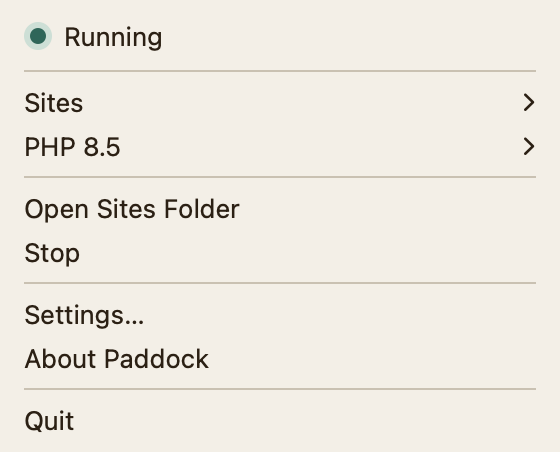
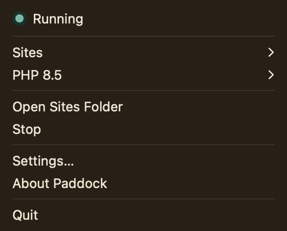
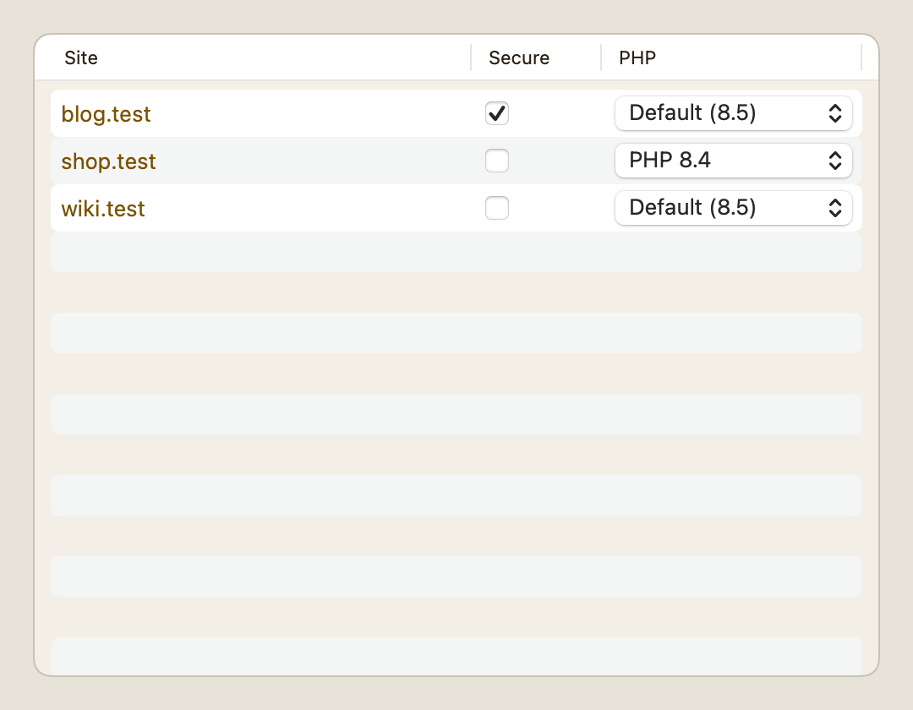
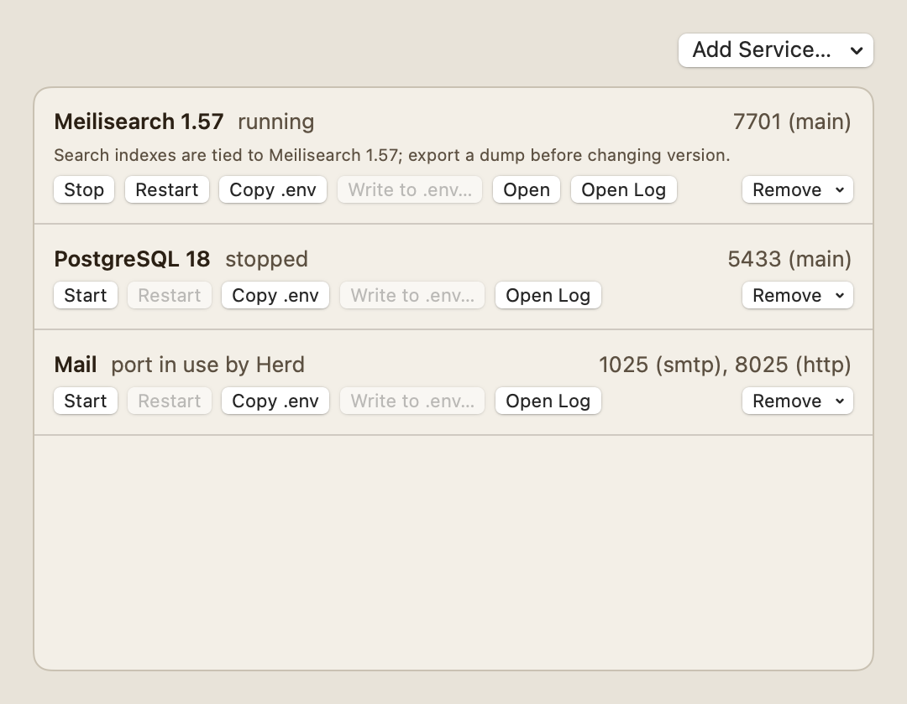
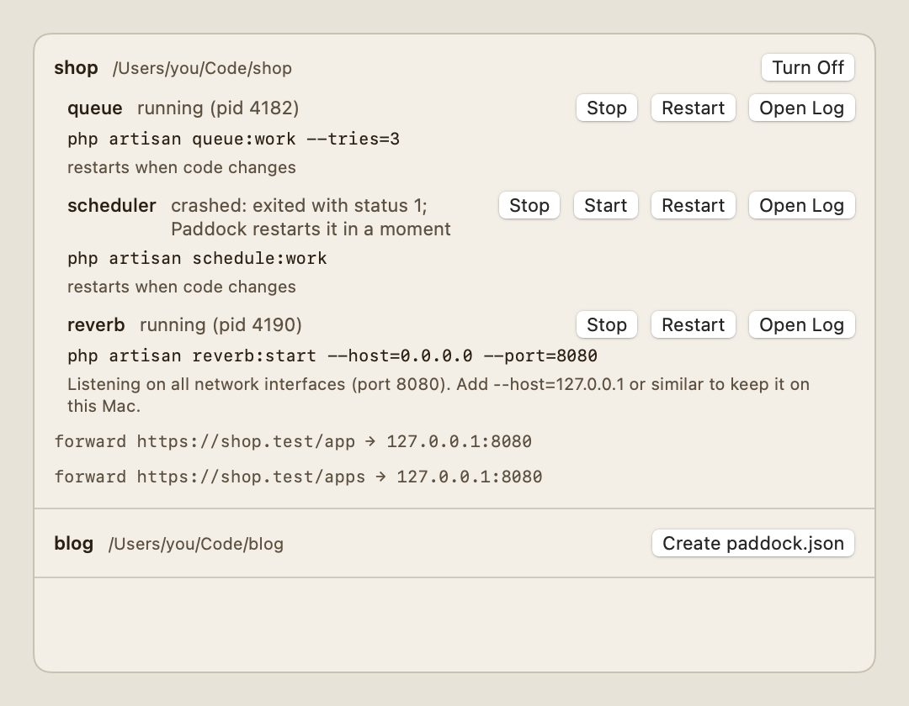
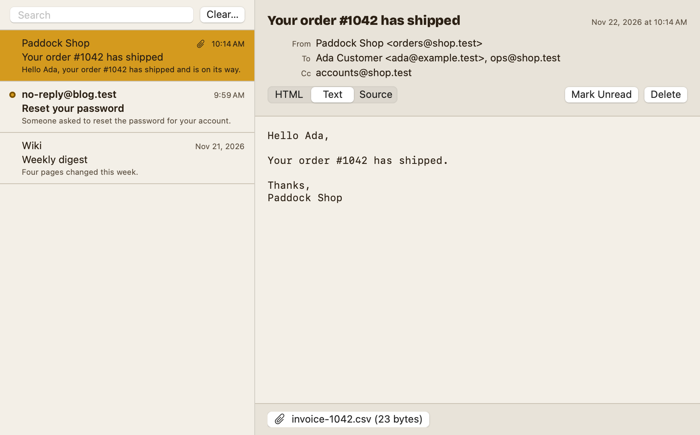
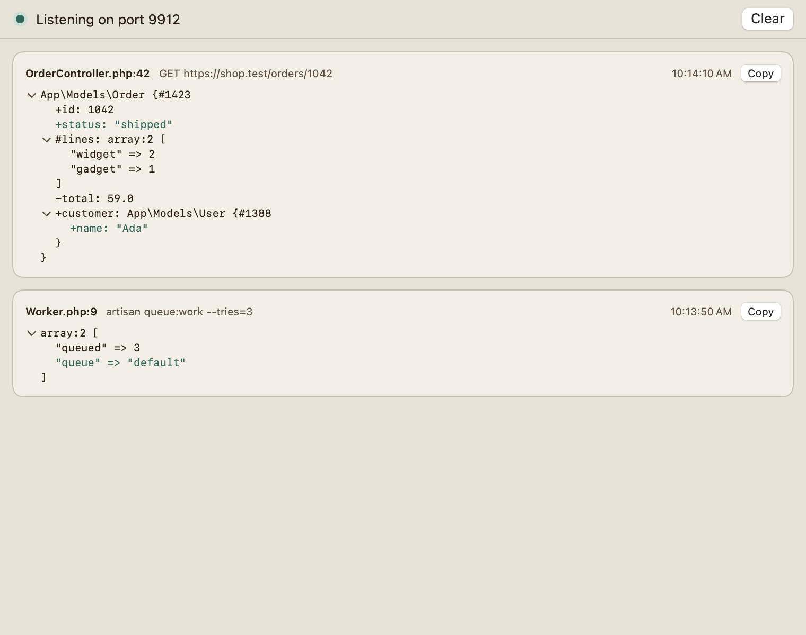
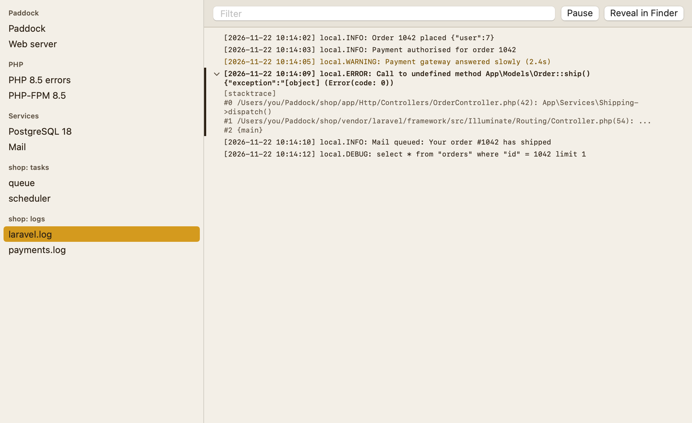
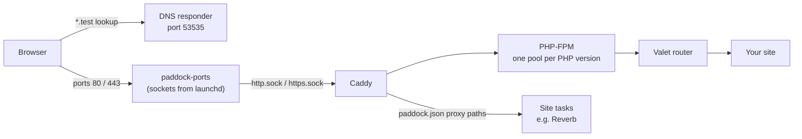

<p align="center">
  
</p>

<h1 align="center">Paddock</h1>

<p align="center">
  <strong>A local PHP and Laravel environment for Intel Macs that works the moment it is installed.</strong>
</p>

<p align="center">
  <a href="#quick-start">Quick start</a> ·
  <a href="#what-you-get">What you get</a> ·
  <a href="#the-paddock-cli">CLI</a> ·
  <a href="#services">Services</a> ·
  <a href="#the-mail-window">Mail</a> ·
  <a href="#site-tasks-and-paddockjson">Site tasks</a> ·
  <a href="#how-it-works">How it works</a> ·
  <a href="#building-from-source">Build</a>
</p>

---

Laravel Herd no longer ships for Intel Macs. Paddock gives Intel Mac users the
same thing Herd gives everyone else: drag it to Applications, open it, enter
your password once, and any folder in a parked directory is served at
`<folder>.test`, over trusted HTTPS when you want it.

It is a menu-bar app, a background daemon and a `paddock` command-line tool
that share one Swift core. Caddy, Composer, Valet's request router and
Paddock's own static PHP builds are inside the app, so the first launch works
offline. No Homebrew, no MacPorts, nothing else to install, and nothing asks
you a question Paddock could answer itself.

<p align="center">
  
  &nbsp;&nbsp;
  
</p>

> **Paddock is proprietary software.** Its source is public for transparency,
> but it is not open source. See
> [License and third-party notices](#license-and-third-party-notices).

## Contents

- [What you get](#what-you-get)
- [Requirements](#requirements)
- [Quick start](#quick-start)
- [The menu-bar app](#the-menu-bar-app)
  - [The Mail window](#the-mail-window)
  - [The Logs window](#the-logs-window)
  - [The Dumps window](#the-dumps-window)
- [The `paddock` CLI](#the-paddock-cli)
- [Services](#services)
- [Site tasks and `paddock.json`](#site-tasks-and-paddockjson)
- [How it works](#how-it-works)
- [Files and directories](#files-and-directories)
- [Environment variables](#environment-variables)
- [Uninstalling](#uninstalling)
- [Building from source](#building-from-source)
- [Testing](#testing)
- [Repository layout](#repository-layout)
- [License and third-party notices](#license-and-third-party-notices)
- [Contributing](#contributing)

## What you get

| | |
|---|---|
| **Zero-configuration sites** | Park a directory once and every folder inside it is served at `http://<folder>.test`. Or link a single folder to `<name>.test`. |
| **Trusted local HTTPS** | `paddock secure` serves a site over HTTPS and makes macOS trust Paddock's local certificate authority, so browsers never complain. |
| **PHP versions side by side** | Paddock ships with the newest stable PHP. Other versions are the only downloads, and only when you ask (`paddock use 8.4`). Each site can pin its own. |
| **Xdebug, one switch per PHP version** | Paddock's own Xdebug build loads into a PHP version when you switch it on, and starts a session only when a request asks for one. Your `php.ini` is never edited. |
| **`php` and `composer` that follow you** | The `php` and `composer` commands in your terminal use the PHP version of the site whose folder you are in. |
| **Framework-aware routing** | Paddock vendors and patches Laravel Valet's PHP request router, so Laravel, WordPress, Symfony and friends resolve the way Valet users expect. |
| **One-action services** | Add PostgreSQL, MySQL, Redis (Valkey), Meilisearch, S3-compatible object storage or a local mail catcher with one command or one click. Each prints the exact `.env` lines for a Laravel app. |
| **Project-owned background tasks** | A `paddock.json` in a project keeps its queue worker, scheduler, websocket server and custom scripts running, with your approval, restarted when they crash or the code changes. |
| **A Dumps window** | While it is open, `dump()` and `dd()` from every site and from `php` in the terminal show in Paddock instead of in the page. Close it and they show where they always did. |
| **A Logs window** | Paddock's logs, each service's, each site task's and each site's own `storage/logs`, in one window that follows them as they are written. Laravel errors fold their stack traces. |
| **A Mail window** | Read the mail your apps send, caught locally: HTML, plain text and source, with attachments. Remote content stays blocked until you ask for it. |
| **A native menu-bar app** | Start and stop, open sites, switch PHP versions, manage services and tasks. No configuration forms. |

## Requirements

- An **Intel Mac (x86_64)** running **macOS 13 or later**.
- Nothing else for day-to-day use. The app is standalone.
- To build from source: Xcode with the Swift 6 toolchain.

## Quick start

1. **Install.** Download or [build](#building-from-source) `Paddock.app` and
   move it to `/Applications`.
2. **Open Paddock.** The first launch asks for your password **once**, to
   install the `.test` DNS resolver and the port 80/443 entry. No Paddock code
   runs as root after that.
3. **Add Paddock to your terminal.** In the menu-bar app, choose
   Settings… → General → "Add Paddock to Terminal", so `php`, `composer` and
   `paddock` work in new terminal windows.
4. **Park your projects folder.**

   ```sh
   paddock park ~/Sites
   ```

   Every folder in `~/Sites` is now served at `<folder>.test`.
5. **Turn on HTTPS for a site.**

   ```sh
   paddock secure mysite
   ```

   `mysite.test` is now served over HTTPS and macOS trusts Paddock's
   certificate (one extra prompt, the very first time only).
6. **Add a database.**

   ```sh
   paddock service add postgres 18
   ```

   PostgreSQL 18 is downloaded, initialized and started, and its `.env` lines
   are printed.
7. **Catch your app's mail.**

   ```sh
   paddock service add mail
   ```

   Put the `.env` lines it prints into your app. Mail the app sends now stops
   at Paddock instead of going out, and you read it from the menu's **Mail**
   row. See [The Mail window](#the-mail-window).
8. **Keep a Laravel project's workers running.** Inside the project:

   ```sh
   paddock tasks init
   paddock tasks on
   ```

   Its queue worker and scheduler now run whenever Paddock runs.

## The menu-bar app

The menu shows whether Paddock is running, your sites, the default PHP version
and, once a mail service is added, your unread mail. Settings… has five tabs:
General, PHP, Sites, Services and Tasks.

<p align="center">
  
  
</p>
<p align="center">
  
</p>

- **Sites:** open a site, secure it with a checkbox, pin its PHP version.
- **PHP:** install and remove versions, choose the default, switch Xdebug on
  or off for a version, open `php.ini`.
- **Services:** add, start, stop, restart and remove services, copy a
  service's `.env` lines, and open its log.
- **Tasks:** review and approve a site's `paddock.json`, then start, stop and
  restart its tasks and open their logs.
- **General:** start at login, manage parked folders, add Paddock to your
  terminal, and restore your previous setup.

When something else holds ports 80 or 443, the menu names the program and
offers to quit it. Paddock never fights another web server for its ports.

### The Mail window

Once the mail service is added, the menu gains a **Mail** row with the unread
count. It opens a window listing the mail your apps sent to the catcher,
newest first, updated as mail arrives.

<p align="center">
  
</p>

- Read a message as **HTML**, **Text** or **Source** (exactly as it arrived,
  headers included).
- Remote images, styles and fonts in an HTML message are **blocked until you
  choose Load Remote Content**, so a tracking pixel is not fetched just because
  you looked. Scripts never run, and links open in your browser.
- Save attachments with one click.
- Opening a message marks it read; **Mark Unread** puts it back.
- **Search** narrows the list by sender, recipient, subject or body.
- **Delete** removes the open message. **Clear…** deletes every caught
  message, after asking.

The window needs the mail service running; when it isn't added or isn't
running, the window says so and how to fix it. The mail service's Open button
in Settings… → Services opens this window too. Mailpit's own web page is still
there: `paddock service open mail`.

### The Dumps window

**Dumps** in the menu opens a window that collects what your sites `dump()`.

<p align="center">
  
</p>

- **While the window is open**, `dump()` and `dd()` in any site, and in `php`
  run from the terminal, show here instead of in the page. Each says the file
  and line it is on and the request or command it came from.
- **Close the window** and they show in the page again, as before. Nothing is
  left changed.
- Arrays and objects are a tree: click a chevron to fold or unfold. Values read
  exactly as VarDumper prints them in a terminal. **Copy** puts a dump on the
  pasteboard as that text.
- Nothing to set up in a project, and none of Paddock's code runs in your
  requests.

How it works: Paddock listens on `127.0.0.1:9912`, the way Symfony's own
`dump-server` does, and tells PHP to send dumps there with the two variables
VarDumper reads (`VAR_DUMPER_FORMAT=server`, `VAR_DUMPER_SERVER`). Laravel and
Symfony both honour them. If nothing is listening, VarDumper itself falls back
to showing the dump in the page.

Worth knowing:

- A queue worker or other long-running command started **before** you opened
  the window does not know about it; restart the task and its dumps arrive too.
- Port 9912 is the one `php artisan dump-server` uses. Only one of the two can
  listen at a time; the window says so if the port is taken.
- A project that sets `VAR_DUMPER_FORMAT` itself keeps its own choice.

### The Logs window

**Logs** in the menu opens every log in one place, grouped:

- **Paddock:** the daemon and the web server.
- **PHP:** each version's errors and PHP-FPM's own log.
- **Services:** one per added service.
- **A site's tasks:** one per task in its `paddock.json`.
- **A site's logs:** every `.log` file in its `storage/logs`, `laravel.log`
  first, then the most recently written (the newest 20).

<p align="center">
  
</p>

- The chosen log shows from its end and **follows as it is written**: a new
  line appears within about a second, with no refresh.
- In a Laravel log, an entry's stack trace is **folded under it**; click the
  chevron to see it. Errors are bold with a bar beside them, warnings amber.
- **Filter** narrows to entries mentioning a word, stack traces included.
- **Pause** stops new lines arriving while you read; it catches up when you
  go on.
- **Reveal in Finder** shows the file itself.
- Open Log on a task or a service in Settings… opens this window at that log.

Paddock only reads these files. It never rotates, clears or edits a site's
own logs.

The pictures in this section are rendered from sample data by the app's own
snapshot tool (`PaddockApp --snapshots <dir>`).

## The `paddock` CLI

Run `paddock --help` or `paddock <command> --help` for details. Commands that
take a site default to the one containing the current directory.

### Sites

| Command | What it does |
|---|---|
| `paddock park [dir]` | Serve every folder in a directory at `<folder>.test` (default: the current directory). |
| `paddock forget [dir]` | Stop serving a parked directory. |
| `paddock parked` | List the parked directories. |
| `paddock link [name]` | Serve the current directory at `<name>.test` (default: the folder's name). |
| `paddock unlink [name]` | Stop serving a linked site. |
| `paddock links` | List the linked sites. |
| `paddock secure [site]` | Serve a site over HTTPS and trust Paddock's certificate. |
| `paddock unsecure [site]` | Serve a site over plain HTTP. |
| `paddock trust` | Make macOS trust Paddock's certificate for HTTPS sites. |
| `paddock open [site]` | Open a site in the browser. |

### PHP

| Command | What it does |
|---|---|
| `paddock use 8.4` | Make a PHP version the default for every site, downloading it if needed. |
| `paddock isolate 8.4` | Pin the current site to a PHP version. |
| `paddock unisolate` | Return the current site to the default PHP version. |

Paddock supports PHP 8.1 and later.

### Xdebug

| Command | What it does |
|---|---|
| `paddock xdebug` | Show which PHP versions have Xdebug on. |
| `paddock xdebug on [8.4]` | Switch Xdebug on for a PHP version (default: the current site's, else the default). |
| `paddock xdebug off [8.4]` | Switch it off. |
| `paddock xdebug zed` | Write Zed's debug configuration (`.zed/debug.json`) for the current site; never over an existing one. |

Xdebug is switched per PHP version: every site on that version follows, and so
does `php` in the terminal. Switching restarts that version's PHP-FPM, nothing
else. While it is on:

- A debugging session starts **only when asked for**: the Xdebug browser
  extension, `?XDEBUG_TRIGGER=1` on a URL, or `XDEBUG_TRIGGER=1 php artisan …`
  in the terminal. Other requests run as usual.
- Your editor listens on **port 9003** on this Mac, Xdebug's default. No path
  mappings are needed: the files are where your editor sees them. To use
  another port or host, set `xdebug.client_port` or `xdebug.client_host` in
  that version's `php.ini`.
- Every request enters through Paddock's router, so with "break at first line"
  on, your editor stops in `router/server.php` first. Set a breakpoint in your
  own code instead.
- `composer` never loads Xdebug.
- Paddock's defaults are `xdebug.mode=debug` and
  `xdebug.start_with_request=trigger`. Set either in that version's `php.ini`
  and yours is used instead, for example
  `xdebug.mode = debug,develop,coverage`. For a one-off in the terminal:
  `XDEBUG_MODE=coverage php artisan test --coverage`.

Xdebug is Paddock's own build of Xdebug 3.5.3, in the app, so switching it on
needs no network. Paddock loads it from PHP's command line; your `php.ini` is
never edited.

#### Zed

Zed's PHP extension brings its own Xdebug debug adapter. In a site's folder:

```sh
paddock xdebug on
paddock xdebug zed
```

The second command writes `.zed/debug.json` with the entry Zed's PHP
documentation gives:

```json
[
  {
    "label": "PHP: Listen to Xdebug",
    "adapter": "Xdebug",
    "request": "launch",
    "port": 9003
  }
]
```

Then, in Zed: set a breakpoint, run `debugger: start` (F4), choose
"PHP: Listen to Xdebug", and load the page with `?XDEBUG_TRIGGER=1` (or with
the Xdebug browser extension on). If the file already exists, Paddock prints
the entry for you to add instead. If your `php.ini` sets
`xdebug.client_port`, the entry uses that port.

#### VS Code and PhpStorm

- **VS Code:** install the "PHP Debug" extension, add its "Listen for Xdebug"
  configuration (port 9003), and start it.
- **PhpStorm:** turn on "Start Listening for PHP Debug Connections". Its
  debug port is 9003 by default. Turn off "Break at first line in PHP
  scripts", or it stops in Paddock's router on every request.

### Lifecycle

| Command | What it does |
|---|---|
| `paddock start` | Start Paddock. |
| `paddock stop` | Stop Paddock. |
| `paddock restart` | Restart Paddock. |
| `paddock status` | Show whether Paddock is running, and its sites. |
| `paddock logs` | Show the end of each Paddock log. |
| `paddock uninstall` | Remove Paddock's resolver, port 80/443 entry, login item and certificate trust. Keeps your sites and data. |

### Services

| Command | What it does |
|---|---|
| `paddock service list` | List the services you added. |
| `paddock service available` | List the services Paddock can add. |
| `paddock service add <kind> [version]` | Download, set up and start a service, and print its `.env` lines. |
| `paddock service start <name>` | Start a service. |
| `paddock service stop <name>` | Stop a service. |
| `paddock service restart <name>` | Restart a service. |
| `paddock service remove <name> [--delete-data]` | Stop and remove a service. Data is kept unless `--delete-data`, which asks first. |
| `paddock service update <name>` | Download the newest version of a service's series and switch to it. |
| `paddock service create-db <name> <database>` | Create a database in a running PostgreSQL or MySQL service. |
| `paddock service env <name>` | Print a service's `.env` lines for a Laravel app. |
| `paddock service logs <name>` | Show the end of a service's log. |
| `paddock service open <name>` | Open a service's page in the browser. |

A service's name is like `mail` or `postgres-18`. A version is a series such as
`18`, or an exact version.

### Site tasks

| Command | What it does |
|---|---|
| `paddock tasks list` | List a site's tasks, or every site's when run outside a site folder. |
| `paddock tasks init` | Write a starter `paddock.json` for a Laravel project (never over an existing one). |
| `paddock tasks on [--show]` | Show every command in the site's `paddock.json` and approve them, so they run with Paddock. |
| `paddock tasks off` | Stop the site's tasks and withdraw their approval. |
| `paddock tasks start <task>` | Start a task. |
| `paddock tasks stop <task>` | Stop a task. It stays stopped across restarts until started again. |
| `paddock tasks restart <task>` | Restart a task. |
| `paddock tasks logs <task> [-f] [-n <n>]` | Show the end of a task's log, optionally following it. |

## Services

`paddock service available` lists what Paddock can add. One action downloads,
initializes and starts a service with working defaults. There are no forms.

| Kind | Service | Series | Notes |
|---|---|---|---|
| `postgres` | PostgreSQL | 18, 17, 16 | Includes PostGIS 3.6.4 (no raster or topology). |
| `mysql` | MySQL | 9.7, 8.4 | Oracle's Community Server, `root` with no password. 8.4.11 is the last 8.4 release Oracle built for Intel Macs. |
| `redis` | Redis (Valkey) | 9 | Valkey, a Redis-compatible server. Laravel's Redis client works unchanged. Bundled, so adding it needs no download. |
| `storage` | Object Storage (S3) | 4 | SeaweedFS 4.17, S3-compatible. A `paddock` bucket is made for you; the key and secret are fixed, for development on this Mac only. |
| `meilisearch` | Meilisearch | 1.57 | A random master key is generated per instance and shown in its `.env`. Search indexes are tied to the series. |
| `mail` | Mail (Mailpit) | 1 | An SMTP catcher on port 1025 with a web page and API on port 8025. Paddock's [Mail window](#the-mail-window) reads from it. |

Every service:

- listens on loopback only;
- prints its Laravel `.env` lines when added, and again with
  `paddock service env <name>`;
- starts and stops with Paddock;
- keeps its data through stop, restart, app updates, uninstall and remove,
  unless you explicitly ask to delete it.

## Site tasks and `paddock.json`

A `paddock.json` at the root of a site defines its long-running tasks and, for
websocket servers, reverse-proxy routes on the site's own HTTPS address:

```json
{
  "tasks": {
    "queue":       { "run": "php artisan queue:work redis --queue=default,scout,media,listeners --tries=3" },
    "scheduler":   { "run": "php artisan schedule:work" },
    "reverb":      { "run": "php artisan reverb:start --host=127.0.0.1 --port=8080" },
    "flutterwave": { "run": "bun run webhook:flutterwave:forward" }
  },
  "proxy": {
    "/app":  8080,
    "/apps": 8080
  }
}
```

- `tasks`: a name mapped to `run`, one command line. Optional per task:
  `restartOnChange`, `autostart` (default `true`) and `stopSeconds`
  (default 30).
- `proxy`: a path prefix mapped to a local port.
- Unknown keys are errors, so typos fail loudly.

**Nothing runs without your approval.** A site with a `paddock.json` shows as
"tasks need your approval" and runs nothing until you run `paddock tasks on`
or approve it in the app. Approval is tied to the file's contents and to the
folder you approved. If `tasks` or `proxy` change, for example after a
`git pull`, the site keeps running the last approved version and asks you to
review the new one.

Tasks run in the site's folder, with that site's PHP version and your login
shell's environment. The daemon supervises each one in its own process group:
restart with backoff, and a clean SIGTERM-then-SIGKILL shutdown.

## How it works

Paddock is four small executables sharing one library:

| Executable | What it does |
|---|---|
| `PaddockApp` | The menu-bar app. |
| `paddockd` | The background daemon. Runs the web stack, the DNS responder, services and site tasks, and serves IPC over a Unix socket. |
| `paddock` | The command-line tool. Symlinked as `php` and `composer`, it becomes those programs, using the site's PHP version, without parsing arguments. |
| `paddock-ports` | A tiny C helper that copies bytes between ports 80/443 and Caddy's private Unix sockets. |

A request to a `.test` site travels like this:



- **Caddy** listens only on two owner-only Unix sockets (`http.sock` and
  `https.sock`), never on a network port.
- **`paddock-ports`**, registered with launchd during the one-password setup,
  receives the already-open loopback ports 80 and 443 from launchd and forwards
  each connection to Caddy's sockets. Nothing runs as root at runtime.
- **One PHP-FPM pool per PHP version in use** sits behind Caddy.
- **A DNS responder** answers every `*.test` name on port `53535`. A resolver
  entry forwards `.test` to it, so no `/etc/hosts` entry is ever needed.
- **A supervisor** keeps PHP-FPM, Caddy, services and site tasks alive:
  restart with backoff on crashes, clean shutdown, bounded logs, and leftovers
  reclaimed after a daemon crash.

The daemon and the port helper run in the background, started at login. The
menu-bar app is only a window onto them and can stay closed.

## Files and directories

Everything Paddock writes lives under
**`~/Library/Application Support/Paddock`** (`PADDOCK_HOME` overrides this):

| Path | Contents |
|---|---|
| `bin/` | The `php` and `composer` shims, `php-versions/` with installed PHP builds, and `php-extensions/` with Paddock's Xdebug for the versions it was switched on for. |
| `config/` | Regenerated configuration, including the `Caddyfile` and the vendored router home. |
| `php/` | Your PHP settings, such as `php/8.4/php.ini`. Never regenerated. |
| `run/` | Owner-only Unix sockets and pid files. |
| `log/` | Paddock, service and task logs. |
| `services/` | Shared service binaries and one folder per instance (`data/` is kept on remove). |
| `state.json` | Parked directories, links, PHP choices and service state. |

## Environment variables

| Variable | Purpose |
|---|---|
| `PADDOCK_HOME` | Override the data directory (default `~/Library/Application Support/Paddock`). |
| `PADDOCK_HTTP_PORT` | Override the HTTP port (default `80`). |
| `PADDOCK_HTTPS_PORT` | Override the HTTPS port (default `443`). |
| `PADDOCK_DNS_PORT` | Override the DNS responder port (default `53535`). |
| `PADDOCK_RESOURCES` | Override where bundled binaries (Caddy, PHP, …) are found. |
| `PADDOCK_OPEN_COMMAND` | Override the browser opener used by `paddock open` (used by tests). |

## Uninstalling

```sh
paddock uninstall
```

or Settings… → General → "Restore Previous Setup…" in the app. Either removes
Paddock's resolver, port 80/443 entry, login item and certificate trust, and
puts your `.test` DNS setting back. Your sites and your services' data are
kept. Then move `Paddock.app` to the Trash.

## Building from source

The repository does not commit its third-party binaries (`Vendor/` is
gitignored). Fetch them first, then build:

```sh
# 1. Fetch Caddy, Composer, the Valet router and Paddock's PHP builds.
Scripts/fetch-vendor.sh

# 2. Build and test the Swift package (debug).
swift build
swift test

# 3. Build the standalone release app for Intel Macs.
swift Scripts/make-icon.swift   # generates Resources/AppIcon.icns
Scripts/bundle.sh               # produces dist/Paddock.app
```

`Scripts/bundle.sh` builds for `x86_64`, assembles `dist/Paddock.app` with the
bundled binaries and Paddock's own PHP, PostGIS and Valkey archives (so
installing another version needs no network), signs it ad hoc and verifies the
signature.

Paddock's own PHP, Xdebug, PostGIS and Valkey artifacts are built with
`Scripts/build-php.sh`, `Scripts/build-xdebug.sh`, `Scripts/build-postgis.sh`
and `Scripts/build-valkey.sh`. The locked versions and checksums live in
[`Scripts/versions.lock`](Scripts/versions.lock).

## Testing

```sh
swift test
```

- [`Tests/PaddockCoreTests`](Tests/PaddockCoreTests): unit tests for the core
  library (Caddyfile generation, DNS messages, IPC, PHP resolution, path and
  port handling, the app model, and more).
- [`Tests/IntegrationTests`](Tests/IntegrationTests): end-to-end tests that
  start the real daemon, Caddy, PHP-FPM, the DNS responder and services. These
  need the bundled third-party binaries, so run `Scripts/fetch-vendor.sh`
  first.

To review the app's look without running it, render every screen to PNG in
light and dark:

```sh
swift run PaddockApp --snapshots dist/snapshots
```

## Repository layout

```
Sources/
  PaddockApp/     The menu-bar app (SwiftUI).
  PaddockCore/    The engine, daemon logic, services, tasks, web stack and IPC.
  paddock/        The `paddock` command-line tool (ArgumentParser subcommands).
  paddockd/       The background daemon.
  paddock-ports/  The C port-80/443 helper.
Tests/
  PaddockCoreTests/   Unit tests.
  IntegrationTests/   End-to-end tests.
  PaddockTestSupport/ Shared test helpers.
  FakeService/        A stand-in service for the service framework's tests.
Resources/        App icon, headline font, Info.plist, service recipes and the vendored router.
Scripts/          Fetch, build and bundle scripts; version lock file.
Vendor/           Fetched third-party binaries (gitignored).
docs/images/      The pictures in this README.
Scripts/fixtures/ How the VarDumper test fixtures are made.
docs/superpowers/ Design documents and plans.
```

## License and third-party notices

Paddock is **proprietary software**, copyright © 2026 John Gowelle. The
compiled application is free to install and use. Redistribution, modification
and derivative works are not permitted. See [LICENSE](LICENSE).

The Paddock source is public for transparency only; no open-source license is
granted by its availability. Third-party components bundled with Paddock
(Caddy, PHP, Xdebug, Composer, the Valet router, swift-argument-parser, the
Bricolage Grotesque typeface, and the libraries inside Paddock's PHP builds) are licensed under their own terms. See
[THIRD-PARTY-NOTICES](THIRD-PARTY-NOTICES).

## Contributing

Paddock's source is public for transparency, not as open source. By submitting
a contribution you grant the owner the rights described in
[CONTRIBUTING.md](CONTRIBUTING.md). Please read it before opening a pull
request, and do not submit confidential, third-party, patented, or GPL/LGPL
code without prior written approval.
